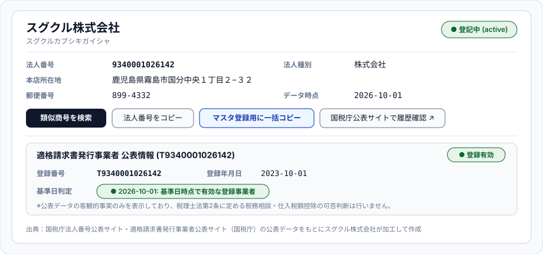

# @sugukuru/mcp-houjin-bangou

> **国税庁の法人番号公表データおよび適格請求書発行事業者（インボイス）公表データを照会・検証できる MCP (Model Context Protocol) サーバー。**

[](https://cursor.com/install-mcp?name=houjin-bangou&config=eyJ1cmwiOiJodHRwczovL2hvdWppbi5tY3Auc3VndS1rdXJ1LmNvLmpwL21jcCJ9)
[](https://vscode.dev/redirect/mcp/install?name=houjin-bangou&config=%7B%22type%22%3A%22http%22%2C%22url%22%3A%22https%3A%2F%2Fhoujin.mcp.sugu-kuru.co.jp%2Fmcp%22%7D)
[](https://www.npmjs.com/package/@sugukuru/mcp-houjin-bangou)
[](LICENSE)
[](https://github.com/SUGUKURU-CO-LTD/mcp-houjin-bangou/actions/workflows/ci.yml)
[](https://modelcontextprotocol.io/specification/2025-11-25)

🌐 English README: [README.md](README.md)  
🔗 製品案内・規約: [製品案内](https://sugu-kuru.co.jp/mcp/houjin) | [利用規約](https://sugu-kuru.co.jp/mcp/houjin/terms) | [プライバシーポリシー](https://sugu-kuru.co.jp/mcp/houjin/privacy)



## 30秒で導入（APIキー不要・ホスト版）

エンドポイント **`https://houjin.mcp.sugu-kuru.co.jp/mcp`** を追加するだけで、全5ツール・4プロンプト・インタラクティブ MCP Apps UI を即座に利用できます。

- **Claude Code（1行コマンド）**:
  ```bash
  claude mcp add --transport http houjin-bangou https://houjin.mcp.sugu-kuru.co.jp/mcp
  ```
- **Google Antigravity (AGY)**:
  ```bash
  agy plugin install https://github.com/SUGUKURU-CO-LTD/mcp-houjin-bangou
  ```
- **Claude Desktop / Claude.ai / ChatGPT（非エンジニア向け GUI 3ステップ）**:
  1. **設定（Settings）** → **コネクタ（Connectors）** → **カスタムコネクタを追加** を開く。
  2. リモート MCP サーバー URL に `https://houjin.mcp.sugu-kuru.co.jp/mcp` を入力して保存（認証不要）。
  3. チャットで「スグクル株式会社の法人番号とインボイス登録状況を教えて」「請求書の T9340001026142 が 2026-10-01 時点で有効か確認して」と話しかけるだけ！

---

## 概要

Claude、ChatGPT、Cursor、Google Antigravity、VS Code Copilot などの MCP 対応クライアントから、以下の機能を利用できます。

1. **法人番号（13桁）による法人照会** (`lookup_corporate_by_number`) — 1件の法人番号から商号・フリガナ・本店所在地・郵便番号・法人種別・閉鎖の有無と事由・承継先法人番号（`successor_corporate_number`）・住居表示実施に伴う所在地注記フラグ（`address_may_be_outdated`）を取得できます。
2. **法人名による検索** (`search_corporate_by_name`) — 都道府県コード（`01`〜`47`）での絞り込み・カーソルページングに加え、ホスト版DBでは**完全一致・存続法人優先の2段階ランキング**、半角/全角英数字および半角/全角スペース展開（`Apple Japan` ⇔ `Ａｐｐｌｅ　Ｊａｐａｎ`）、旧字体⇔新字体双方向展開（`野村証券` ⇔ `野村證券`、`高橋` ⇔ `髙橋`）、小書きカナ双方向展開（`キャノン` ⇔ `キヤノン`、`富士フィルム` ⇔ `富士フイルム`）、ひらがな→カタカナ併記検索（`すぐくる` → `スグクル`）に対応しています。
3. **適格請求書発行事業者（`T`+13桁）の照会** (`lookup_invoice_issuer`) — 登録番号（`T` + 13桁）の登録状態、登録年月日、取消・失効年月日、および指定した取引基準日（`reference_date`）時点での登録有効性の事実確認（`was_registered_on_reference_date`）を行います。
4. **チェックデジットのローカル検証** (`validate_corporate_number`) — 外部通信を一切行わずに13桁の法人番号の検査用数字（モジュラス9）を検証します。
5. **会社名の表記揺れ正規化** (`normalize_company_name`) — `(株)` / `㈱` / `株式会社` 等の略称展開・前後位置変換、各種法人種別の分離、英語表記（`K.K.` / `Co., Ltd.` / `LLC` 等）の変換、NFKC、旧字体→新字体変換（全75字）、異体字セレクタ（IVS）除去を決定論的に実行し、正規化後商号と検索最適化クエリを生成します。

---

## 2つの動作モード

### 1. ホスト版 / PostgreSQL モード（`DATA_SOURCE=db` — リモート Streamable HTTP）

- 国税庁の「法人番号公表サイト」および「適格請求書発行事業者公表サイト」の公開ダウンロードデータ（全件 CSV）を月1回取り込んだ PostgreSQL 16（`pg_trgm`）データベースから全5ツール（`lookup_invoice_issuer` を含む）に高速応答します。
- 利用者側での API キー取得は不要であり、実行時に国税庁 Web-API のアプリケーション ID を使用しません。
- `/mcp` エンドポイントへの `Origin` ヘッダ許可リスト検証、接続元 IP アドレス単位のレート制限（`Retry-After` 付与）、およびデータベースの 3 ロール権限分離（`houjin_admin` / `houjin_ingest` / `houjin_reader`）を備えています。

### 2. ローカル実行 / セルフホストモード（HTTP）

- 利用者自身の環境でローカル Streamable HTTP サーバー（既定ポート `3001`）を起動し、以下のいずれかで利用できます：
  - **国税庁 Web-API モード（`DATA_SOURCE=web-api`、既定）**: 利用者自身が取得した `NTA_APPLICATION_ID` を使って法人番号の照会・検索を行います。※ `lookup_invoice_issuer` はデータベース接続専用のため、`web-api` モードでは `DATA_UNAVAILABLE` を返します（インボイス照会にはホスト版または下記 DB モードをご利用ください）。
  - **ローカル PostgreSQL モード（`DATA_SOURCE=db`）**: `npm run db:migrate`（同梱の `drizzle/` SQL マイグレーション適用）および取り込み CLI（`src/ingest/cli.ts`）で公表 CSV を投入した手元の PostgreSQL 16（`DATABASE_URL`）に接続し、全5ツールをローカル運用できます。

```bash
# 国税庁 Web-API モードで起動（既定ポート: 3001）
NTA_APPLICATION_ID="あなたのアプリケーションID" npx @sugukuru/mcp-houjin-bangou
```

#### クライアント別 設定ファイル記述例

##### Cursor（`.cursor/mcp.json` または `~/.cursor/mcp.json`）
```json
{
  "mcpServers": {
    "houjin-bangou": {
      "type": "streamable-http",
      "url": "https://houjin.mcp.sugu-kuru.co.jp/mcp"
    }
  }
}
```

##### Claude Code（`.mcp.json` または `~/.claude.json`）
```json
{
  "mcpServers": {
    "houjin-bangou": {
      "type": "http",
      "url": "https://houjin.mcp.sugu-kuru.co.jp/mcp"
    }
  }
}
```

##### VS Code（`.vscode/mcp.json`）
```json
{
  "servers": {
    "houjin-bangou": {
      "type": "http",
      "url": "https://houjin.mcp.sugu-kuru.co.jp/mcp"
    }
  }
}
```

##### Claude Desktop（`claude_desktop_config.json` を使う場合）
Claude Desktop ではアプリ内の **「設定 → コネクタ（Connectors）」** から `https://houjin.mcp.sugu-kuru.co.jp/mcp` を直接追加する方法を推奨します（MCP Apps UI もそのまま表示されます）。設定ファイル `claude_desktop_config.json` で接続する場合は、`"url"` 単体ではなく `mcp-remote` ブリッジを指定してください：
```json
{
  "mcpServers": {
    "houjin-bangou": {
      "command": "npx",
      "args": ["-y", "mcp-remote", "https://houjin.mcp.sugu-kuru.co.jp/mcp"]
    }
  }
}
```

##### ローカル HTTP モード（セルフホスト）
ターミナルで上記の起動コマンドを実行したうえで、クライアント側には `http://localhost:3001/mcp` を各クライアント形式（Cursor は `"type": "streamable-http"`、Claude Code / VS Code は `"type": "http"`、`claude_desktop_config.json` は `"args": ["-y", "mcp-remote", "http://localhost:3001/mcp"]`）で設定します（※ `@sugukuru/mcp-houjin-bangou` 自体を stdio の `"command"` に指定しないでください）。詳細は [`examples/`](examples/) を参照してください。

---

## ツール一覧（全5ツール）

| ツール名 | 用途 | アノテーション (`readOnly` / `destructive` / `idempotent` / `openWorld`※) | 備考 |
|---|---|---|---|
| `lookup_corporate_by_number` | 13桁の法人番号による単一法人照会 | `true` / `false` / `true` / `true` | 基本情報・閉鎖情報・承継先法人番号（`successor_corporate_number`）・所在地注記フラグを返却。UI `ui://corporate-card/mcp-app.html` 対応 |
| `search_corporate_by_name` | 法人名による検索 | `true` / `false` / `true` / `true` | 都道府県コード（`01`〜`47`）・`limit`（`1`〜`20`）・`cursor` 対応。略称・旧字体は先に `normalize_company_name` を実行。UI `ui://search-results/mcp-app.html` 対応 |
| `lookup_invoice_issuer` | 適格請求書発行事業者（`T`+13桁）の照会 | `true` / `false` / `true` / `true` | `reference_date`（`YYYY-MM-DD`）で基準日有効性（`was_registered_on_reference_date`）を照合。**ホスト版 / `DATA_SOURCE=db` 専用**。UI `ui://corporate-card/mcp-app.html` 対応 |
| `validate_corporate_number` | 法人番号チェックデジット検証 | `true` / `false` / `true` / `false` | ローカル純粋関数（外部通信なし、両モード共通） |
| `normalize_company_name` | 会社名の表記揺れ正規化 | `true` / `false` / `true` / `false` | ローカル純粋関数（`normalized_name`・`legal_type`・`search_query_optimized` を出力、両モード共通） |

※ **`openWorld` アノテーションに関する注記**:
`openWorldHint` はサーバーがツールごとに宣言する注釈（メタデータ）であり、クライアントから送信されるものではありません。
- ディレクトリ掲載基準（公開実体エンティティを扱うツールは `true`、仕様書 v1.8+）に基づき、照会ツール3種（`lookup_corporate_by_number`, `search_corporate_by_name`, `lookup_invoice_issuer`）はホスト版・ローカル版ともに `openWorldHint: true` となります。
- 純粋関数ツール2種（`validate_corporate_number`, `normalize_company_name`）は外部通信を行わずローカル計算のみで完結するため、両モードで `openWorldHint: false` です。

---

## プロンプト（4種）と MCP Apps UI リソース（2種）

- **Prompts**:
  - `invoice-verification-check`: 受領した請求書・領収書の `T`+13桁登録番号・取引年月日・発行元法人名を渡し、基準日時点のインボイス登録事実と法人の存続・合併承継・社名一致を一括点検して確認記録を作成します（税務判断・個人連絡先は扱いません）。
  - `company-master-record`: 会社名や所在地の手がかりから表記揺れを正規化し、法人番号・正式商号・本店所在地を照会して取引先マスタ登録用レコードを作成します（個人名や連絡先等の個人情報は扱いません）。
  - `sales-list-enrichment`: 複数社のリスト（1回最大20社）に対して法人番号・正式名称・所在地を一括付与します。
  - `customer-master-dedup`: 顧客マスタ内の表記揺れ・移転・合併による重複候補を検出します。
- **MCP Apps UI リソース（`@modelcontextprotocol/ext-apps` v1.7 ＋ ChatGPT `openai/outputTemplate` 互換）**:
  - `ui://corporate-card/mcp-app.html`: `lookup_corporate_by_number`（法人番号コピー・**Excel/ERP/kintone 貼り付け用の「マスタ登録用に一括コピー」**・法人格を除いたコア名での類似商号検索・承継先法人ドリルダウン・ワンクリックでのインボイス登録確認＆基準日ピッカー）および `lookup_invoice_issuer`（インボイス登録確認カード・法人基本情報への相互遷移）のインタラクティブ表示。
  - `ui://search-results/mcp-app.html`: `search_corporate_by_name` のレスポンシブ一覧表示（状態フィルタ・`next_cursor` ページ送り・履歴スタックによる戻るナビゲーション・OS 文字サイズ拡大追従・`updateModelContext` 同期対応）。
  - UI を描画しない CLI やヘッドレスクライアントでも、`content`（要約テキスト）と `structuredContent`（構造化 JSON）だけで全ての情報を過不足なく利用できます。

---

## プライバシー・セキュリティ・データ更新頻度

- **入力値の非記録**: 利用者が入力した法人番号、インボイス登録番号、検索語はアプリケーションログやエラー応答に記録・露出しません。
- **個人事業者情報の保護**: 適格請求書発行事業者のうち個人事業者のデータについては、氏名・屋号・所在地をデータベースに取り込まず、出力もしません（登録番号 `T`+13桁、人格区分、登録・取消・失効等の日付のみを保持し、完全一致照会のみを提供します）。
- **月1回のデータ更新**: ホスト版の公表データは月1回（前月末時点の全件データ）で更新されます。月途中の変更・取消・失効や、法人番号の処理区分「99（削除）」・インボイス公表申出の取り下げ等は次回の月次更新まで反映されません。各応答にはデータの基準日（`data_as_of`）が含まれます。
- **事実照会への限定**: `was_registered_on_reference_date` を含む本サーバーの出力は `data_as_of` 時点の公表データ上の日付との事実照合結果であり、個別の税務相談・税務判断を提供するものではありません。

---

## ドキュメント

- [はじめに (Getting Started)](docs/getting-started.md)
- [API リファレンス](docs/api-reference.md)
- [活用クックブック (Usage Cookbook)](docs/usage-cookbook.md)
- [アーキテクチャ](docs/architecture.md)
- [MCP Apps UI リソース](docs/ui-resources.md)
- [トラブルシューティング](docs/troubleshooting.md)
- [ホスト版 構築・運用手順書](docs/deployment/hosted.md)
- [DB ロール設計と権限分離](docs/deployment/db-roles.md)
- [セルフホストガイド](docs/deployment/self-hosting.md) / [Docker 構成ガイド](docs/deployment/docker.md) / [npx クイックスタート](docs/deployment/npx-quickstart.md)
- [プロンプトインジェクション防御](docs/security/prompt-injection-defense.md)
- [プライバシーポリシー](docs/policy/privacy-policy.md) ([英語版](docs/policy/privacy-policy.en.md))
- [利用規約](docs/policy/terms-of-service.md) ([英語版](docs/policy/terms-of-service.en.md))
- [設計決定記録 (ADR)](docs/adr/)
- [SECURITY](SECURITY.md) / [CONTRIBUTING](CONTRIBUTING.md) / [CODE OF CONDUCT](CODE_OF_CONDUCT.md)

---

## 出典表示

- **法人番号公表データ**: 国税庁法人番号公表サイト（`https://www.houjin-bangou.nta.go.jp/`） — 公共データ利用規約 第1.0版
- **適格請求書発行事業者公表データ**: 国税庁適格請求書発行事業者公表サイト（`https://www.invoice-kohyo.nta.go.jp/`） — 公共データ利用規約 第1.0版
- **Web-API 免責表示（ローカル `web-api` モード時）**:
  > このサービスは、国税庁法人番号システムWeb-API 機能を利用して取得した情報をもとに作成しているが、サービスの内容は国税庁によって保証されたものではない

## ライセンス・運営事業者

- **ライセンス**: MIT © 2026 スグクル株式会社（鹿児島県霧島市）
- **Webサイト**: [https://sugu-kuru.co.jp](https://sugu-kuru.co.jp)
- **連絡先**: `info@sugu-kuru.co.jp`
