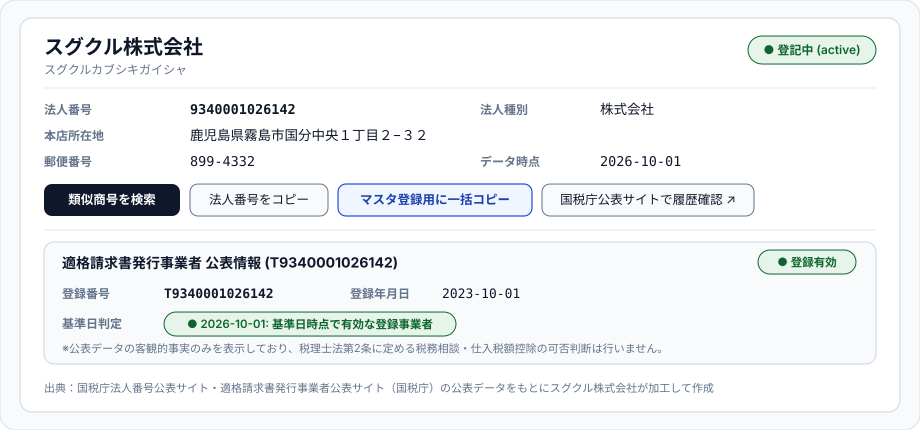

# @sugukuru/mcp-houjin-bangou

> **Model Context Protocol (MCP) server for looking up and verifying Japanese Corporate Numbers (法人番号) and Qualified Invoice Issuers (適格請求書発行事業者) published by the National Tax Agency of Japan.**

[](https://cursor.com/install-mcp?name=houjin-bangou&config=eyJ1cmwiOiJodHRwczovL2hvdWppbi5tY3Auc3VndS1rdXJ1LmNvLmpwL21jcCJ9)
[](https://vscode.dev/redirect/mcp/install?name=houjin-bangou&config=%7B%22type%22%3A%22http%22%2C%22url%22%3A%22https%3A%2F%2Fhoujin.mcp.sugu-kuru.co.jp%2Fmcp%22%7D)
[](https://www.npmjs.com/package/@sugukuru/mcp-houjin-bangou)
[](LICENSE)
[](https://github.com/SUGUKURU-CO-LTD/mcp-houjin-bangou/actions/workflows/ci.yml)
[](https://modelcontextprotocol.io/specification/2025-11-25)

🇯🇵 日本語版 README: [README.ja.md](README.ja.md)  
🔗 Official Product Pages: [Product Overview](https://sugu-kuru.co.jp/mcp/houjin) | [Terms of Service](https://sugu-kuru.co.jp/mcp/houjin/terms) | [Privacy Policy](https://sugu-kuru.co.jp/mcp/houjin/privacy)



## Quick Connect (Zero API Key — Hosted Edition)

Connect immediately to **`https://houjin.mcp.sugu-kuru.co.jp/mcp`** (all 5 tools + 4 prompts + interactive MCP Apps UI):

- **Claude Code (1 command)**:
  ```bash
  claude mcp add --transport http houjin-bangou https://houjin.mcp.sugu-kuru.co.jp/mcp
  ```
- **Google Antigravity (AGY)**:
  ```bash
  agy plugin install https://github.com/SUGUKURU-CO-LTD/mcp-houjin-bangou
  ```
- **Claude Desktop / Claude.ai / ChatGPT (Web & Desktop UI)**:
  1. Open **Settings** → **Connectors** (or **Apps & Connectors**) → **Add Custom Connector**.
  2. Enter Server URL: `https://houjin.mcp.sugu-kuru.co.jp/mcp` (no authentication required).
  3. Start asking about any Japanese company name, 13-digit corporate number, or `T`+13-digit invoice number!

---

## Overview

An MCP server that enables Claude, ChatGPT, Cursor, Google Antigravity, VS Code Copilot, and any MCP-compatible client to:

1. **Look up a Japanese corporation** by its 13-digit National Corporate Number (`lookup_corporate_by_number`), returning published name, furigana, head-office address, postal code, legal type, closure status/cause, successor corporate number (`successor_corporate_number`), and outdated-address flag (`address_may_be_outdated`).
2. **Search corporations by name** (`search_corporate_by_name`) with optional 2-digit JIS prefecture filter (`01`–`47`), cursor-based pagination, 2-stage exact/active-first ranking, and automatic expansion across half/full-width ASCII & spaces (`Apple Japan` ⇔ `Ａｐｐｌｅ　Ｊａｐａｎ`), old/new kanji (`野村証券` ⇔ `野村證券`, `高橋` ⇔ `髙橋`), small/large katakana (`キャノン` ⇔ `キヤノン`, `富士フィルム` ⇔ `富士フイルム`), and hiragana-to-katakana (`すぐくる` → `スグクル`) in Hosted DB mode.
3. **Verify a Qualified Invoice Issuer** by registration number (`lookup_invoice_issuer`, `T` + 13 digits), with optional factual registration check as of a specified reference date (`reference_date` → `was_registered_on_reference_date`).
4. **Validate check digits locally** (`validate_corporate_number`) with zero external network calls.
5. **Normalize fuzzy company names** (`normalize_company_name`) deterministically across Japanese corporate-name patterns (expansion and position swaps of `(株)` / `㈱` / `株式会社` and other legal entities, English-to-Japanese suffixes such as `K.K.` / `Co., Ltd.` / `LLC`, NFKC, 75 old-to-new kanji variants, IVS stripping, and whitespace canonicalization).

---

## Two Operating Modes

### 1. Hosted / PostgreSQL Mode (`DATA_SOURCE=db` — Remote Streamable HTTP)

- Serves all 5 tools (including `lookup_invoice_issuer`) from a PostgreSQL 16 (`pg_trgm`) database populated monthly from the National Tax Agency's public bulk download datasets (all-records CSVs for Corporate Numbers and Qualified Invoice Issuers).
- Requires zero API keys for end users and does not use an NTA Web-API Application ID at runtime.
- Enforces `/mcp` `Origin` header allowlist verification, per-IP rate limiting (`Retry-After`), and 3-role database privilege separation (`houjin_admin`, `houjin_ingest`, `houjin_reader`).

### 2. Local / Self-Hosted Mode (HTTP)

- Runs locally as a Streamable HTTP server (default port `3001`) using either:
  - **NTA Web-API mode (`DATA_SOURCE=web-api`, default)**: Uses your own NTA Web-API Application ID (`NTA_APPLICATION_ID`) for corporate number lookups and searches. Note that `lookup_invoice_issuer` is not available in `web-api` mode (returns `DATA_UNAVAILABLE`) and requires `DATA_SOURCE=db` or the Hosted Edition.
  - **Local PostgreSQL mode (`DATA_SOURCE=db`)**: Connects to your own PostgreSQL 16 database (`DATABASE_URL`) migrated via `npx @sugukuru/mcp-houjin-bangou` (`npm run db:migrate`) and populated via the bundled ingestion CLI (`src/ingest/cli.ts`), enabling all 5 tools locally.

```bash
# Run in local NTA Web-API mode (default port: 3001)
NTA_APPLICATION_ID="YOUR_NTA_APPLICATION_ID" npx @sugukuru/mcp-houjin-bangou
```

#### MCP Client Configuration Examples

##### Cursor (`.cursor/mcp.json` or `~/.cursor/mcp.json`)
```json
{
  "mcpServers": {
    "houjin-bangou": {
      "type": "streamable-http",
      "url": "https://houjin.mcp.sugu-kuru.co.jp/mcp"
    }
  }
}
```

##### Claude Code (`.mcp.json` or `~/.claude.json`)
```json
{
  "mcpServers": {
    "houjin-bangou": {
      "type": "http",
      "url": "https://houjin.mcp.sugu-kuru.co.jp/mcp"
    }
  }
}
```

##### VS Code (`.vscode/mcp.json`)
```json
{
  "servers": {
    "houjin-bangou": {
      "type": "http",
      "url": "https://houjin.mcp.sugu-kuru.co.jp/mcp"
    }
  }
}
```

##### Claude Desktop (`claude_desktop_config.json` fallback)
Prefer adding `https://houjin.mcp.sugu-kuru.co.jp/mcp` via **Settings → Connectors** in Claude Desktop. If your environment requires `claude_desktop_config.json` (which expects a local `command` entry rather than a bare `url`), bridge via `mcp-remote`:
```json
{
  "mcpServers": {
    "houjin-bangou": {
      "command": "npx",
      "args": ["-y", "mcp-remote", "https://houjin.mcp.sugu-kuru.co.jp/mcp"]
    }
  }
}
```

##### Local HTTP Mode (Self-Hosted)
After starting the local HTTP server in a terminal (`http://localhost:3001/mcp`), connect using `"type": "streamable-http"` (Cursor) or `"type": "http"` (Claude Code / VS Code), or `"args": ["-y", "mcp-remote", "http://localhost:3001/mcp"]` in `claude_desktop_config.json` (do not pass `@sugukuru/mcp-houjin-bangou` directly as a stdio `"command"`). See [`examples/`](examples/) for complete sample files.

---

## Tools (5)

| Tool | Purpose | Annotations (`readOnly` / `destructive` / `idempotent` / `openWorld`*) | Notes |
|---|---|---|---|
| `lookup_corporate_by_number` | Look up 1 corporation by 13-digit corporate number | `true` / `false` / `true` / `true` | Returns basic info, closure details, `successor_corporate_number`, and `address_may_be_outdated`. Linked to `ui://corporate-card/mcp-app.html`. |
| `search_corporate_by_name` | Search corporations by name & filters | `true` / `false` / `true` / `true` | Optional `prefecture` (`01`–`47`), `limit` (`1`–`20`), and `cursor`. Call `normalize_company_name` first for abbreviated/fuzzy names. Linked to `ui://search-results/mcp-app.html`. |
| `lookup_invoice_issuer` | Look up Qualified Invoice Issuer by `T` + 13 digits | `true` / `false` / `true` / `true` | Optional `reference_date` (`YYYY-MM-DD`) returns `was_registered_on_reference_date`. Requires Hosted Edition or `DATA_SOURCE=db`. Linked to `ui://corporate-card/mcp-app.html`. |
| `validate_corporate_number` | Local Modulo-9 check-digit validation | `true` / `false` / `true` / `false` | Pure function; no DB or network access (both modes). |
| `normalize_company_name` | Deterministic Japanese company-name normalization | `true` / `false` / `true` / `false` | Pure function; extracts `normalized_name`, `legal_type`, and `search_query_optimized` (both modes). |

* **Note on `openWorld` annotation**:
`openWorldHint` is declared by the server for each tool as metadata and is not sent by clients.
- In accordance with directory submission guidelines for public/open-ended entities (v1.8+ specification), data lookup tools (`lookup_corporate_by_number`, `search_corporate_by_name`, `lookup_invoice_issuer`) declare `openWorldHint: true` across both Hosted Edition and Local Mode.
- Pure calculation tools (`validate_corporate_number`, `normalize_company_name`) declare `openWorldHint: false` in both modes as they operate purely in memory without external data lookups.

---

## Prompts (4) & MCP Apps UI Resources (2)

- **Prompts**:
  - `invoice-verification-check`: Verify a received invoice's `T`+13-digit registration number, transaction date (`reference_date`), and corporate existence/merger succession in one step, producing a factual accounting verification record (no tax advice; no personal contact fields).
  - `company-master-record`: Normalize a company name, search NTA records, and format a clean corporate master entry (strictly corporate data only; no personal contact fields).
  - `sales-list-enrichment`: Enrich a list of company names (up to 20 per request) with 13-digit corporate numbers and published head-office addresses.
  - `customer-master-dedup`: Detect duplicate customer master records caused by notation variants, mergers, or relocations.
- **MCP Apps UI Resources (`@modelcontextprotocol/ext-apps` v1.7 + ChatGPT `openai/outputTemplate`)**:
  - `ui://corporate-card/mcp-app.html`: Interactive card view for both `lookup_corporate_by_number` (Corporate Card with corporate-number copy, **one-click TSV Vendor Master bulk copy** for Excel/ERP/kintone, core-name similar-company search, successor drill-down, and one-click Qualified Invoice cross-check + reference-date picker) and `lookup_invoice_issuer` (Invoice Verification Card with corporate profile link).
  - `ui://search-results/mcp-app.html`: Responsive table/card view for `search_corporate_by_name` with status filter pills, interactive `next_cursor` pagination, view-history back navigation, OS text-scale adaptation, and `updateModelContext` synchronization.
  - Every tool also returns complete human-readable text (`content`) and machine-readable `structuredContent`, so headless CLI or non-UI clients fulfill all workflows without loss of information.

---

## Privacy, Security & Data Freshness

- **No input logging**: Corporate numbers, invoice registration numbers, and search queries are never written to application logs or leaked in error messages.
- **Sole proprietor protection**: For individual (sole proprietor) invoice issuers, personal names, trade names, and addresses are never imported into the database or returned by any tool—only the registration number (`T` + 13 digits), entity classification, and registration/cancellation/expiration dates are stored.
- **Monthly data refresh**: The hosted database is updated once per month (snapshot as of the end of the preceding month). Mid-month changes, revocations, or deletion requests (process code `99`) are reflected in the next monthly update. Every response includes `data_as_of`.
- **Factual lookup only**: Date comparisons (`was_registered_on_reference_date`) represent a mechanical comparison against published registration periods as of `data_as_of` and do not constitute tax or legal advice.

---

## Documentation

- [Getting Started](docs/getting-started.md)
- [API Reference](docs/api-reference.md)
- [Usage Cookbook](docs/usage-cookbook.md)
- [Architecture](docs/architecture.md)
- [MCP Apps UI Resources](docs/ui-resources.md)
- [Troubleshooting](docs/troubleshooting.md)
- [Hosted Deployment Runbook](docs/deployment/hosted.md)
- [Database Roles & Privilege Separation](docs/deployment/db-roles.md)
- [Self-Hosting Guide](docs/deployment/self-hosting.md) / [Docker Guide](docs/deployment/docker.md) / [npx Quickstart](docs/deployment/npx-quickstart.md)
- [Prompt Injection Defense](docs/security/prompt-injection-defense.md)
- [Privacy Policy](docs/policy/privacy-policy.md) ([English](docs/policy/privacy-policy.en.md))
- [Terms of Service](docs/policy/terms-of-service.md) ([English](docs/policy/terms-of-service.en.md))
- [Architecture Decision Records](docs/adr/)
- [SECURITY](SECURITY.md) / [CONTRIBUTING](CONTRIBUTING.md) / [CODE OF CONDUCT](CODE_OF_CONDUCT.md)

---

## Attribution

- **Corporate Number Data**: National Tax Agency Corporate Number Publication Site (`https://www.houjin-bangou.nta.go.jp/`) — Public Data License v1.0 (公共データ利用規約 第1.0版)
- **Qualified Invoice Issuer Data**: National Tax Agency Qualified Invoice Issuer Publication Site (`https://www.invoice-kohyo.nta.go.jp/`) — Public Data License v1.0 (公共データ利用規約 第1.0版)
- **Web-API Disclaimer (Self-Hosted `web-api` mode)**:
  > このサービスは、国税庁法人番号システムWeb-API 機能を利用して取得した情報をもとに作成しているが、サービスの内容は国税庁によって保証されたものではない

## License & Maintainer

- **License**: MIT © 2026 SUGUKURU CO., LTD. (スグクル株式会社, Kagoshima, Japan)
- **Website**: [https://sugu-kuru.co.jp](https://sugu-kuru.co.jp)
- **Contact**: `info@sugu-kuru.co.jp`
