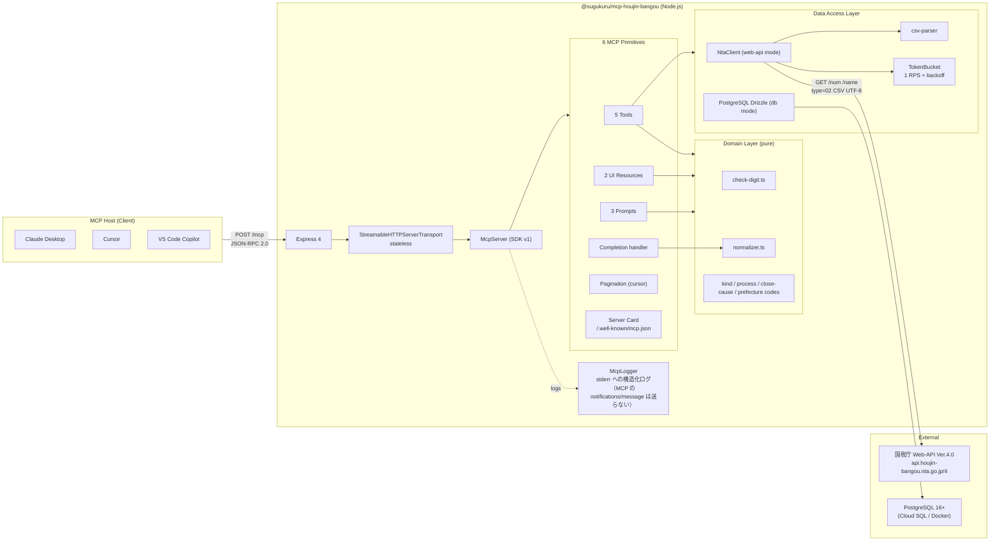
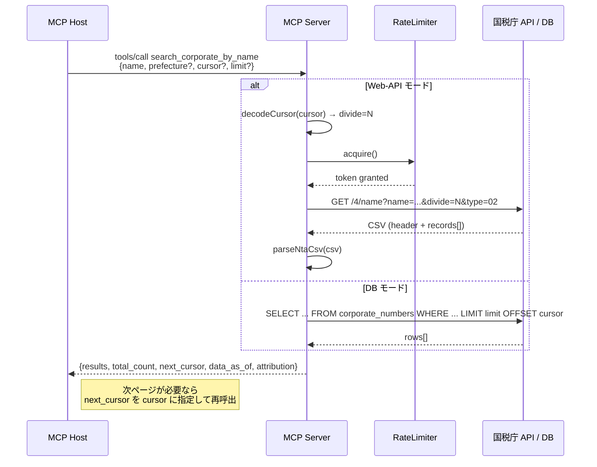

# Architecture / アーキテクチャ

## 全体図 / Overview



## レイヤー構造 / Layered Structure

| Layer | Path | Responsibility |
|---|---|---|
| **Transport** | `src/server.ts` | Express + Streamable HTTP boot + stateless transport |
| **MCP Protocol** | `src/mcp.ts` | McpServer factory + capability negotiation |
| **Primitives** | `src/tools/` `src/resources/` `src/prompts/` `src/completion/` | Tool / Resource / Prompt / Completion handlers |
| **Domain** | `src/domain/` | 純粋ロジック (check-digit, normalizer, codes) |
| **Data Access** | `src/api/` `src/db/` | NTA API client (Web-API) / Drizzle ORM (DB) |
| **Cross-cutting** | `src/lib/` | env / errors / result / logger / pagination |

## データフロー: 法人名検索 + ページング



## データフロー: 企業マスタ確認ワークフロー (Prompt)

```mermaid
sequenceDiagram
  participant U as User
  participant LLM as Claude
  participant P as Prompt<br/>"company-master-record"
  participant NORM as normalize_company_name
  participant SRCH as search_corporate_by_name
  participant CARD as ui://corporate-card/...

  U->>LLM: 会社マスタ確認指示<br/>"（株）スグクルの情報を確認して"
  LLM->>P: prompts/get company-master-record<br/>{company_name: "（株）スグクル"}
  P-->>LLM: 構造化プロンプト (normalize → search → lookup)
  LLM->>NORM: tools/call normalize_company_name<br/>{raw_name: "（株）スグクル"}
  NORM-->>LLM: {normalized_name: "スグクル株式会社", legal_type: "株式会社", search_query_optimized: "スグクル"}
  LLM->>SRCH: tools/call search_corporate_by_name<br/>{name: "スグクル"}
  SRCH-->>LLM: {results: [{corporate_number: "9340001026142", ...}], total_count: 1, ...}
  LLM->>U: 企業情報カード UI (corporate-card) と要約テキストを表示

## プロンプトインジェクション防御層

```mermaid
flowchart TB
  Input["Untrusted LLM Input"]
  L1["L1: Zod strict input validation<br/>additionalProperties: false"]
  L2["L2: Static tool description<br/>CI grep guard"]
  L3["L3: Env-only Application ID<br/>never via tool args"]
  L4["L4: Rate limit + backoff<br/>1 RPS token bucket"]
  L5["L5: Log redaction<br/>***REDACTED***"]
  L6["L6: Attribution required<br/>on every output"]
  Api["NTA Web-API"]
  Output["Safe Output"]

  Input --> L1
  L1 --> L2
  L2 --> L3
  L3 --> L4
  L4 --> Api
  Api --> L5
  L5 --> L6
  L6 --> Output
```

## 参考 / References

- 国税庁 Web-API 仕様書 第一編 (4.9版) / 第二編 (1.2版) / 第六編 (1.2版)
- MCP 公式仕様 (2025-11-25)
- 2026 MCP Roadmap (2026-03-09)
- Transport WG "Exploring the Future of MCP Transports" (2025-12-19)
- SEP-2127 Server Card (Draft) / SEP-1303 Input Validation (Final) / SEP-986 Tool Names (Final)
- Simon Willison "MCP has prompt injection security problems" (2025-04-09)
