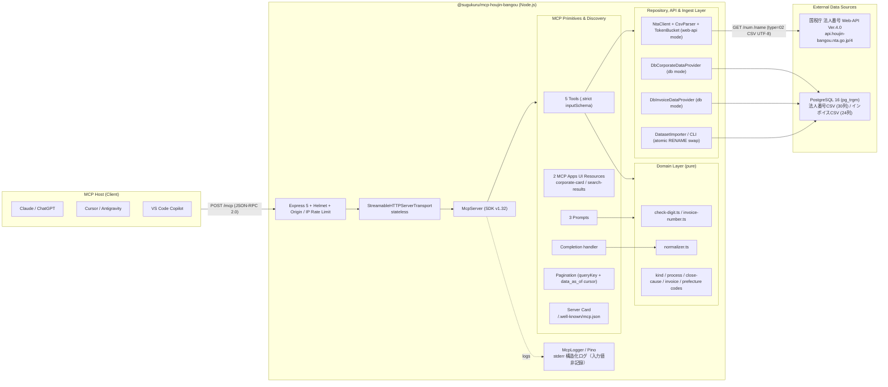
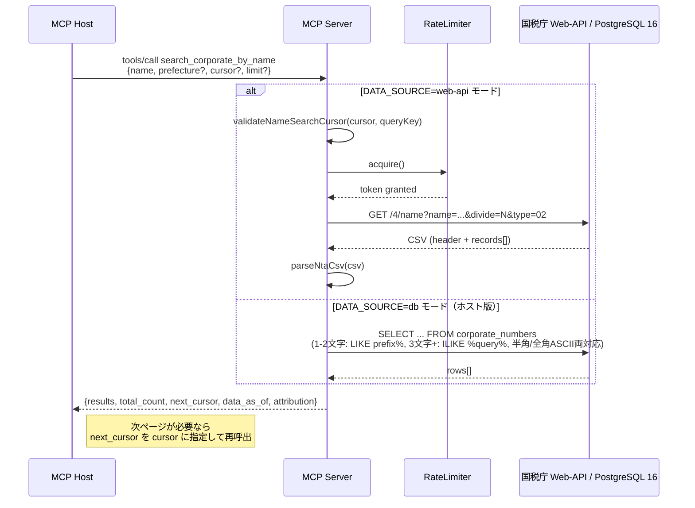
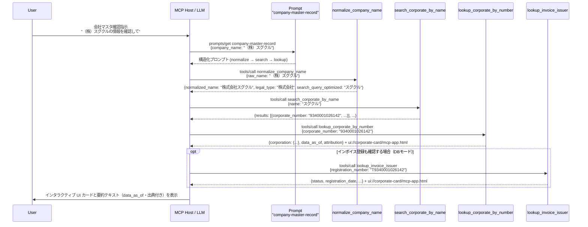
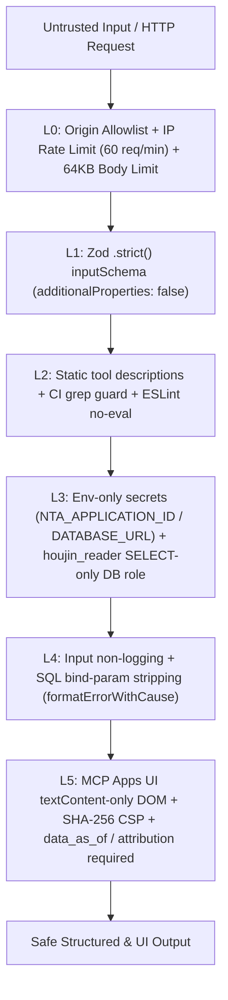

# Architecture / アーキテクチャ

## 全体図 / Overview

## レイヤー構造 / Layered Structure

| Layer | Path | Responsibility |
|---|---|---|
| **Transport & HTTP Security** | `src/server.ts`, `src/lib/http-security.ts` | Express 5 + Helmet + Origin 検証 + IP レート制限 + Stateless Streamable HTTP |
| **MCP Protocol** | `src/mcp.ts` | `McpServer` ファクトリ + capability / `instructions` 宣言 |
| **Primitives & UI** | `src/tools/`, `src/resources/`, `src/prompts/`, `src/completion/`, `src/ui/` | 5 Tools / 2 MCP Apps UI Resources / 3 Prompts / Completion |
| **Domain** | `src/domain/` | 純粋ロジック（チェックデジット、T番号・暦日検証、社名正規化、コード表） |
| **Repository & API** | `src/repository/`, `src/api/`, `src/db/` | PostgreSQL Drizzle プロバイダ（`db` モード）/ 国税庁 Web-API クライアント（`web-api` モード） |
| **Ingestion** | `src/ingest/` | 月次全件 CSV ストリーミング取込・閾値検証・単一トランザクション `RENAME` スワップ |
| **Cross-cutting** | `src/lib/` | 環境変数検証、エラー整形（バインド値秘匿）、ロガー、カーソルページング |

## データフロー: 法人名検索 + ページング

## データフロー: 企業マスタ確認ワークフロー (Prompt + MCP Apps UI)

## プロンプトインジェクション・多層防御

## 参考 / References

- 国税庁 法人番号システム Web-API 仕様書 第一編 (4.9版) / 第二編 (1.2版) / 第六編 (1.2版) / リソース定義書 (4.0版)
- 国税庁 適格請求書発行事業者公表システム ダウンロードデータ リソース定義書 (1.5版 別紙1)
- Model Context Protocol Specification (`2025-11-25`) & MCP Apps (`@modelcontextprotocol/ext-apps` `2026-01-26`)
- SEP-2127 Server Card / SEP-1303 Input Validation as Tool Errors / SEP-986 Tool Names
- Simon Willison, "Model Context Protocol has prompt injection security problems" (2025-04-09)
