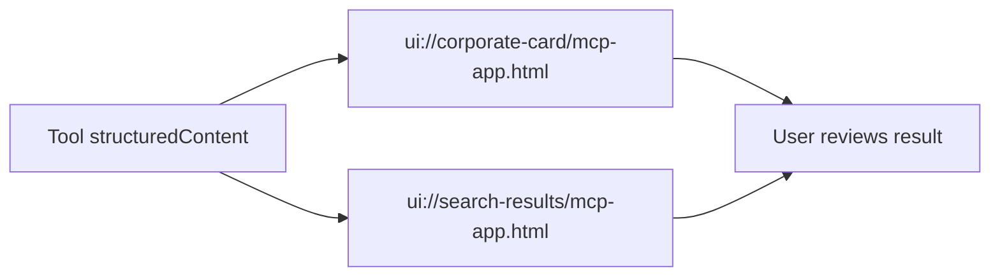

# UI Resources

MCP Apps / UI Resources は、既存の 5 Tools に重ねる表示層として実装されている。

## 目的

UI は新しい業務ロジックを持たない。Tool の structured output を、人間が確認しやすい形に変換する純粋なプレゼンテーション層である。



## Resources

| URI | 用途 | 接続 Tool |
|---|---|---|
| `ui://corporate-card/mcp-app.html` | 単一法人の詳細カード | `lookup_corporate_by_number` |
| `ui://search-results/mcp-app.html` | 法人名検索結果の表 | `search_corporate_by_name` |

## Tool metadata

`tools/list` に以下の `_meta.ui.resourceUri` を出す。

```json
{
  "lookup_corporate_by_number": {
    "_meta": {
      "ui": { "resourceUri": "ui://corporate-card/mcp-app.html" }
    }
  },
  "search_corporate_by_name": {
    "_meta": {
      "ui": { "resourceUri": "ui://search-results/mcp-app.html" }
    }
  }
}
```

## UI actions

UI から server tool を呼ぶ動線:

- `corporate-card`
  - 法人情報（`legal_type`, `location`, `name_kana`, `status`, `close_date`, `close_cause`, `address_may_be_outdated`）、`data_as_of`、および `attribution` を表示
  - 「類似商号を検索」 → `search_corporate_by_name`（引数: `{ name }`）
  - 「法人番号をコピー」 → クリップボードにコピー
- `search-results`
  - 検索結果一覧（`results`, `total_count`, `next_cursor`）を表形式で表示
  - 行クリック → `lookup_corporate_by_number`（引数: `{ corporate_number }`）で詳細再照会

## セキュリティ・DOM 操作

- `innerHTML` や `insertAdjacentHTML` を一切使用せず、`document.createElement` と `textContent` のみで DOM を構築（XSS / Prompt Injection 防御）。
- `scripts/compute-csp-hashes.ts` がビルド後の HTML から inline script/style の SHA-256 ハッシュを計算し、`<meta http-equiv="Content-Security-Policy">` を注入する。
- UI は直接外部 API fetch を行わず、MCP Host の postMessage 経由で動作する。

## Build

```bash
pnpm build:ui
pnpm build:csp
```

生成物:

```text
dist/ui/corporate-card/mcp-app.html
dist/ui/search-results/mcp-app.html
```

Vite + `vite-plugin-singlefile` により、HTML / JS / CSS は 1 ファイルへ inline される。

## Preview fixtures

実機ホストなしで表示設計を確認するため、合成データを用いた fixture を用意:

- `docs/assets/ui-fixtures/corporate-card.json`
- `docs/assets/ui-fixtures/search-results.json`
- `docs/assets/ui-preview.html`

`ui-preview.html` は MCP Host の `postMessage` handshake に依存しない静的プレビューとして利用可能。
