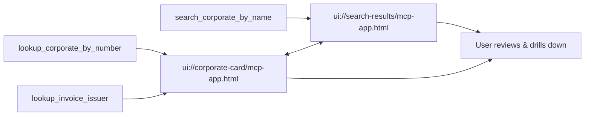

# UI Resources (MCP Apps)

MCP Apps (`io.modelcontextprotocol/ui`, `@modelcontextprotocol/ext-apps`) は、ツールが返す `structuredContent` に重ねる双方向インタラクティブ表示層として実装されている。UI 非対応（ヘッドレス / CLI）のクライアントでも `content` と `structuredContent` のみで全機能が完結する。

## 目的

UI は独自の業務判定や税務判断を持たず、ツールの公表事実出力を人間が確認・深掘りしやすいカードおよび一覧表に変換するプレゼンテーション層である。



## Resources

| URI | 用途 | 接続 Tool |
|---|---|---|
| `ui://corporate-card/mcp-app.html` | 単一法人の詳細カード・適格請求書発行事業者照会カード | `lookup_corporate_by_number`, `lookup_invoice_issuer` |
| `ui://search-results/mcp-app.html` | 法人名検索結果の一覧表（フィルタ・ページ送り対応） | `search_corporate_by_name` |

## Resource & Tool Metadata

各 UI リソースは `resources/list` および `resources/read` の双方に以下の `_meta.ui` を付与する:

```json
{
  "csp": {
    "resourceDomains": [],
    "connectDomains": [],
    "frameDomains": [],
    "baseUriDomains": []
  },
  "permissions": {
    "clipboardWrite": {}
  },
  "prefersBorder": false
}
```

## 双方向 UI アクションとホスト連携

UI 内部（`src/ui/views.ts`）では共通の履歴スタック（`← 戻る` ナビゲーション）を持ち、シームレスな相互遷移を提供する:

- **Corporate Card View** (`lookup_corporate_by_number`)
  - 法人情報（`legal_type`, `location`, `post_code`, `name_kana`, `status`, `close_date`, `close_cause`, `successor_corporate_number`, `address_may_be_outdated`）、`data_as_of`、および `attribution` を表示
  - 「法人番号をコピー」 → `navigator.clipboard.writeText` + フォールバック + `role="status"` ライブ通知
  - 「類似商号を検索」 → `search_corporate_by_name`（`{ name }`）を呼び出し、一覧表ビューへ遷移（`← 法人カードに戻る` 対応）
  - 「承継先法人を照会」 → `successor_corporate_number` がある場合、`lookup_corporate_by_number` で承継先カードへ遷移
  - 「インボイス登録を確認 (`T`+13桁)」＋任意の取引基準日指定 → `lookup_invoice_issuer` を呼び出し、カード内で登録状態・基準日有効性・税務免責事項・出典を表示（ローカル `web-api` モードで DB 未接続の場合は案内メッセージを表示）
  - 「国税庁公表サイトで履歴確認 ↗」 → ホストが `openLinks` をサポートする場合に `app.openLink` で変更履歴ページを開く
- **Invoice Issuer Verification View** (`lookup_invoice_issuer`)
  - 登録状態バッジ（`登録有効` / `登録取消` / `登録失効` / `該当なし（未登録または公表対象外）`）、事業者区分、各種年月日、基準日判定、`data_as_of`、`attribution`、`tax_disclaimer` を表示
  - 個人事業者（`individual`）の場合は個人情報保護に基づき氏名・屋号・所在地を非表示とし、その旨の注記を表示
  - 基準日ピッカーによる再照会、登録番号コピー、および法人の場合の「法人基本情報カードを表示」ボタンを提供
- **Search Results View** (`search_corporate_by_name`)
  - 検索結果一覧をアクセシブルな表形式（`<caption>`, `<th scope="col">`, コンテナ幅に応じたレスポンシブカード変形）で表示
  - 状態フィルタピル（`すべて` / `登記中のみ` / `閉鎖のみ`）
  - カーソルページネーション（`← 前のページ` / `次のページを表示 →`）
  - 法人名ボタンまたは行クリック → `lookup_corporate_by_number` で詳細カードビューへ遷移（`← 検索結果一覧に戻る` でスクロール位置・フォーカスを復元）
- **ホスト環境適応とモデル文脈同期**
  - `app.connect()` 直後および `hostcontextchanged` でホストテーマ（`applyDocumentTheme`）、CSS 変数（`applyHostStyleVariables`）、`safeAreaInsets`、表示モード（`inline` / `fullscreen` 切替）を反映
  - ドリルダウン・ページ送り・インボイス確認時に `app.updateModelContext` を呼び出し、後続の対話でモデルが現在の表示対象を把握できるようにする

## セキュリティ・アクセシビリティ

- DOM 構築は `document.createElement` と `textContent` のみで行い、生の HTML 文字列シンクを一切使用しない（XSS / Response-Mediated Prompt Injection 防御）。
- `scripts/compute-csp-hashes.ts` がビルド後の単一 HTML から inline `<script>` / `<style>` の SHA-256 ハッシュを計算し、`default-src 'none'`・`connect-src 'none'`・`require-trusted-types-for 'script'` を含む厳格な `<meta http-equiv="Content-Security-Policy">` を注入する。
- ライト・ダーク両テーマで WCAG 2.2 AA コントラスト基準（通常テキスト 4.5:1 以上、UI 境界 3:1 以上）および色だけに依存しない状態記号（`●` / `■` / `▲` / `○`）を満たす。

## Build & Preview

```bash
pnpm build:ui
pnpm build:csp
```

生成物:
- `dist/ui/corporate-card/mcp-app.html`
- `dist/ui/search-results/mcp-app.html`

実機ホスト接続なしの静的プレビューおよび合成データ fixture:
- `docs/assets/ui-fixtures/corporate-card.json`
- `docs/assets/ui-fixtures/search-results.json`
- `docs/assets/ui-preview.html`
